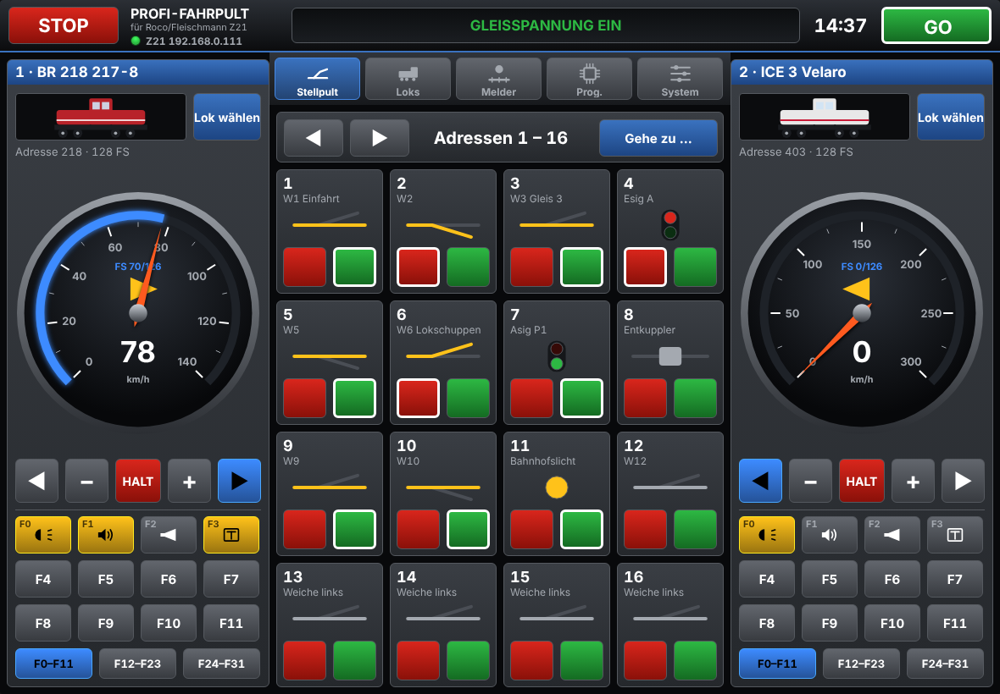

# Profi-Fahrpult

iPad-App zur Steuerung einer Modelleisenbahn über die **Roco/Fleischmann Z21** (auch z21, z21start, Z21 XL).
Die Funktionen orientieren sich an der Z21-App von Roco. Die Oberfläche ist an die
**ESU ECoS** angelehnt: dunkle Bedienoberfläche, zwei Fahrregler mit Tacho-Drehregler,
gelb leuchtende Funktionstasten, rote STOP- und grüne GO-Taste.

> Ein unabhängiges Hobbyprojekt. Es verwendet das öffentlich dokumentierte
> „Z21 LAN Protokoll“ von Roco. Es enthält keinen Code, keine Grafiken und keine Logos von Roco oder ESU.

## Funktionen

| Bereich | Inhalt |
|---|---|
| **Fahren** | 2 Fahrregler nebeneinander, Tacho als Drehregler (kreisende Bewegung), ±1-Fahrstufe, Richtung, HALT (lange drücken = Nothalt der Lok), Funktionen F0–F31 auf 3 Seiten, Moment- und Dauerfunktionen, RailCom-Geschwindigkeit, Hinweis „wird von anderem Gerät gesteuert“ |
| **Loks** | Lokliste mit Name, Adresse (1–9999), 14/28/128 Fahrstufen, Geschwindigkeitsanzeige (km/h bei höchster Fahrstufe oder eingemessene Messpunkte), Einmess-Hilfe mit Stoppuhr, Lokfoto (Mediathek/Kamera), Funktionsbelegung mit 19 Symbolen |
| **Stellpult** | 16 Magnetartikel pro Seite, Adressen 1–2048, rote/grüne Taste, Weichen links/rechts, Signale, Entkuppler, Licht; Rückmeldung der Stellung; Name und Rot/Grün-Tausch per langem Drücken |
| **Melder** | R-Bus-Rückmelder, Module 1–20 mit je 8 Eingängen, Live-Anzeige |
| **Prog.** | CV lesen/schreiben auf dem Programmiergleis, POM (Hauptgleis) schreiben/lesen, Bit-Ansicht, Lokadresse lesen/schreiben (kurz und lang, inkl. CV29) |
| **System** | IP/Port der Z21, Verbinden/Trennen, Hardware, Firmware, Seriennummer, Ströme, Temperatur, Spannungen, Einstellungen (STOP-Verhalten, Schaltzeit, Bildschirmsperre …) |

Der Bildschirm ist wie bei der ECoS aufgebaut: oben die Statusleiste mit STOP (links), Verbindungs- und
Gleisstatus (Gleisspannung ein/aus, Nothalt, Kurzschluss, Programmiermodus), Uhrzeit und GO (rechts).
Im Querformat sitzen die beiden Fahrregler fest am linken und rechten Rand; dazwischen liegt die
Menüleiste mit Symbolen und der gewählte Bereich (Stellpult, Loks, Melder, Prog., System).
Im Hochformat sind die Fahrregler die Seite „Fahren“ in der Menüleiste.



## Loks einmessen

Der Tacho zeigt die Maßstabsgeschwindigkeit der Lok. Unter *Loks → Bearbeiten → Geschwindigkeitsanzeige*
gibt es zwei Wege:

- **km/h bei höchster Fahrstufe:** Ein Wert, z. B. 70. Dazwischen wird gleichmäßig gerechnet
  (Fahrstufe 63 von 126 = 35 km/h). Die Tachoskala geht dann bis 70.
- **Messpunkte:** Beliebig viele Paare „Fahrstufe → km/h“. Zwischen den Punkten wird gerechnet,
  über dem höchsten Punkt mit der Steigung der letzten Strecke weiter. Die Grafik zeigt die Kennlinie.

Die **Einmess-Hilfe** (*Messpunkte und Einmessen → Einmessen mit Stoppuhr*):

1. Maßstab wählen (Z, N, TT, H0, S, 0, 1, G) und die Länge der Messstrecke in cm eingeben.
2. Fahrstufe einstellen und „Lok fahren“ tippen (oder die Lok mit einem anderen Regler fahren).
3. Beim Überfahren der ersten Marke START, bei der zweiten ZIEL tippen. Mehrere Läufe, z. B. hin
   und zurück, werden gemittelt.
4. „Als Messpunkt übernehmen“ – fertig. Für eine gute Kennlinie 4–6 Fahrstufen über den Bereich verteilt messen.

Rechnung: km/h = Strecke (m) ÷ Zeit (s) × 3,6 × Maßstab. Beispiel H0: 1 m in 4,5 s = 69,6 km/h.

## Kompatibilität

- Nur iPad (Hoch- und Querformat).
- Reines UIKit ohne SwiftUI, ohne SF Symbols und ohne Network.framework (UDP über BSD-Sockets).
  Dadurch läuft der Code auch auf älteren iOS-Versionen.
- Im Projekt ist **iOS 12.0** als Mindestversion eingestellt. Das ist das Minimum, das aktuelle
  Xcode-Versionen zulassen; damit laufen u. a. iPad Air 1, iPad mini 2/3 und alle neueren iPads.
- Für noch ältere Geräte (iOS 9–11, z. B. iPad 4 oder iPad mini 1) kann man mit einem älteren
  Xcode (12 oder 13) unter *Target → General → Minimum Deployments* einen kleineren Wert einstellen.
  Der Code prüft neuere Schnittstellen mit `#available`.

## App bauen und auf das iPad bringen

Voraussetzungen: ein Mac mit Xcode und eine (kostenlose) Apple-ID.

1. Repository klonen und `ProfiFahrpult.xcodeproj` in Xcode öffnen.
2. Links das Projekt anklicken → Target **ProfiFahrpult** → *Signing & Capabilities*:
   bei **Team** die eigene Apple-ID wählen. Falls nötig, die *Bundle Identifier*
   (`de.profifahrpult.app`) ändern, z. B. in `de.<deinname>.fahrpult`.
3. iPad per Kabel anschließen, oben als Ziel auswählen und **▶ Run** drücken.
4. Beim ersten Start auf dem iPad den Zugriff auf das **lokale Netzwerk** erlauben.

Mit einer kostenlosen Apple-ID muss die App alle 7 Tage neu aus Xcode installiert werden.
Mit einem kostenpflichtigen Entwicklerkonto gilt sie ein Jahr.

## Verbindung zur Z21

- Das iPad muss im WLAN des Routers sein, an dem die Z21 hängt.
- Werkseinstellung der Z21: IP `192.168.0.111`, UDP-Port `21105` (unter *System* änderbar).
- Die App meldet sich mit `LAN_SET_BROADCASTFLAGS` an, fragt den Systemzustand regelmäßig ab
  (hält die Verbindung aktiv) und verbindet sich bei Unterbrechung selbst neu.
- Beim Wechsel in den Hintergrund meldet sich die App mit `LAN_LOGOFF` ab.

## Testen ohne Z21

Ein Z21-Simulator liegt bei:

```bash
python3 tools/z21_simulator.py
```

In der App unter *System* die IP des Macs eintragen (im iOS-Simulator auf demselben Mac: `127.0.0.1`).
Der Simulator kennt Gleisspannung, Nothalt, Loks, Funktionen, Weichen, CVs und lässt
R-Bus-Melder zufällig wechseln.

## Aufbau des Codes

```
ProfiFahrpult/
  App/          AppDelegate, Info.plist, Startbildschirm
  Z21/          Z21-LAN-Protokoll (Codec), UDP-Socket, Z21Client (Verbindung + Zustand)
  Core/         Rechenlogik ohne UIKit (Geschwindigkeitskennlinie, Maßstäbe)
  Model/        Lok, Lokliste, Magnetartikel, Einstellungen (JSON/UserDefaults)
  UI/           ECoS-Design (Theme), Tacho, Funktionssymbole, alle Bildschirme
Tests/          Unit-Tests für Protokoll und Kennlinie + Integrationstest gegen den Simulator
tools/          z21_simulator.py
```

Die Protokollschicht (`ProfiFahrpult/Z21`) und die Rechenlogik (`ProfiFahrpult/Core`) haben keine UIKit-Abhängigkeit und kann mit
`swift test` geprüft werden (macOS oder Linux):

```bash
swift test
```

Mit laufendem Simulator zusätzlich den Integrationstest ausführen:

```bash
Z21_HOST=127.0.0.1 swift test
```

## Noch nicht enthalten (Ideen für später)

- Gleisbild-Stellwerk mit Fahrstraßen
- Mehrfachtraktion
- LocoNet- und CAN-Rückmelder
- Import der Lokliste aus der Z21-App
- Z21-Einstellungen (z. B. Weichenadress-Versatz RCN-213)
